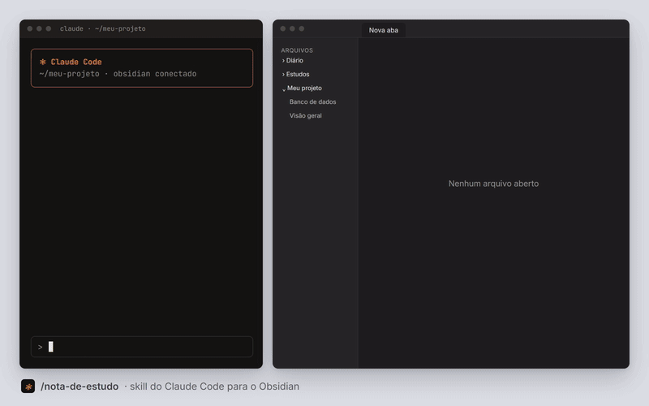

<h1 align="center">/nota-de-estudo</h1>

<p align="center">
  <strong>Uma skill do Claude Code que transforma a conversa em uma nota de estudo no seu Obsidian.</strong><br />
  Feita para você <em>aprender</em> o tema, não só guardar o que foi feito.
</p>

<p align="center">
  
</p>

<p align="center">
  <a href="LICENSE"></a>
</p>

## Instalar

```bash
npx github:carageorgeeric/nota-de-estudo
```

Pronto. Abra (ou reinicie) o Claude Code e digite `/nota-de-estudo`.

| Quero... | Comando |
| --- | --- |
| Instalar para todos os projetos | `npx github:carageorgeeric/nota-de-estudo` |
| Instalar só no projeto atual | `npx github:carageorgeeric/nota-de-estudo --projeto` |
| Atualizar | rode o comando de instalar de novo |
| Remover | `npx github:carageorgeeric/nota-de-estudo --remover` |

> [!TIP]
> Também funciona com o [Skills CLI](https://skills.sh): `npx skills add carageorgeeric/nota-de-estudo`

## Requisitos

1. **[Claude Code](https://claude.com/claude-code)** instalado.
2. **Node.js 16.7 ou mais novo** (só para o `npx`).
3. **Obsidian** com um servidor MCP conectado ao Claude Code. É assim que o Claude lê e escreve no seu vault.

### Conectar o Obsidian ao Claude Code (uma vez só, ~5 min)

1. No Obsidian, abra **Configurações → Plugins da comunidade** e instale o **MCP Connector**.
2. Ative o plugin e copie a **URL** e o **token** que ele mostra nas configurações.
3. No terminal, registre o servidor no Claude Code:

   ```bash
   claude mcp add --transport http obsidian <URL-do-plugin> --header "Authorization: Bearer <seu-token>"
   ```

4. Abra o Claude Code e rode `/mcp`. O `obsidian` deve aparecer como conectado.

> [!NOTE]
> A skill usa os nomes de ferramenta desse plugin (`get_vault_overview`, `search_vault_simple`, `create_vault_file`, `patch_vault_file`). Usa outro servidor MCP do Obsidian? Funciona igual: o Claude usa as ferramentas equivalentes que encontrar.

## Usar

Depois de resolver alguma coisa numa conversa com o Claude Code, peça a nota:

```text
/nota-de-estudo deploy na VPS
```

Sem tema, a nota é sobre o assunto principal da conversa:

```text
/nota-de-estudo
```

Também funciona sem o comando, em linguagem normal:

- "documenta isso no meu Obsidian"
- "cria uma nota pra eu aprender migrations"
- "anota no Obsidian o que a gente fez hoje"

## O que tem na nota

O Claude primeiro olha o seu vault: as pastas, se já existe nota sobre o tema (aí ele **atualiza** em vez de duplicar) e o estilo das notas vizinhas. Depois escreve, usando só as seções que fazem sentido:

| # | Seção | Para quê |
| --- | --- | --- |
| 1 | **Se ler só uma coisa** | 3 a 5 linhas com o essencial, para reler daqui a 3 meses |
| 2 | **O mapa** | Diagrama de como as peças se ligam |
| 3 | **Os conceitos** | Cada conceito com analogia, definição curta e onde aparece no seu projeto |
| 4 | **O que foi feito, passo a passo** | O comando real, o que ele faz e **por que assim** |
| 5 | **Decisões e alternativas** | O que foi escolhido, o que ficou de fora e o custo da escolha |
| 6 | **O que deu errado e o que ensina** | Erros reais da conversa (inclusive os do Claude) |
| 7 | **Dia a dia (cola)** | Tabela `Quero... → Comando` para consulta rápida |
| 8 | **Teste-se** | Perguntas em callouts dobráveis, para responder antes de ver |
| 9 | **Glossário** | Cada termo técnico em uma linha |
| 10 | **Para praticar** | 1 a 3 exercícios de menos de 10 minutos |

### Pensada para quem lê pulando

A skill foi escrita para quem tem TDAH, e ajuda qualquer pessoa que estuda com pouco tempo:

- Parágrafos de no máximo 3 linhas; tabelas e listas no lugar de texto corrido.
- **Negrito** só na palavra-chave, para ler pulando.
- Listas com no máximo 5 itens.
- Comandos sempre prontos para copiar.
- Nunca escreve segredos (senhas, tokens, `.env`): cita só o nome da variável.

## Personalizar

A skill inteira é um arquivo Markdown. Edite e pronto:

| Instalação | Arquivo |
| --- | --- |
| Global | `~/.claude/skills/nota-de-estudo/SKILL.md` |
| Só no projeto | `.claude/skills/nota-de-estudo/SKILL.md` |

Ideias: trocar o idioma, mudar a ordem das seções, adicionar uma seção de "fontes", ou mudar as tags do frontmatter.

> [!WARNING]
> Rodar o comando de instalar de novo **sobrescreve** o `SKILL.md`. Se você personalizou, guarde uma cópia antes de atualizar.

## Licença

[MIT](LICENSE)
